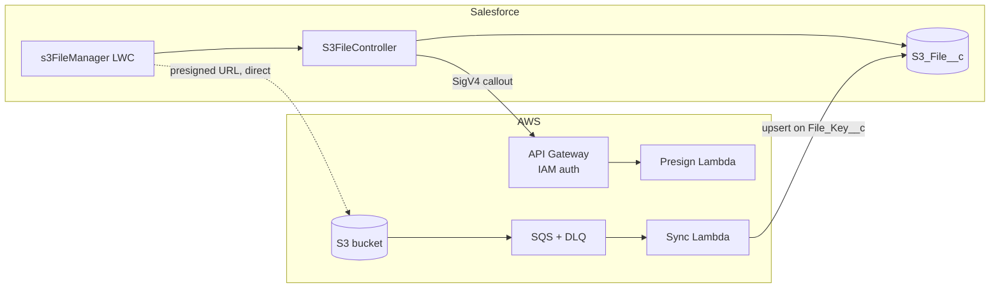

# salesforce-s3-file-storage

Store and serve large Salesforce files in Amazon S3 via presigned URLs, bypassing Apex heap and file size limits. Includes an AWS SAM backend (API Gateway, Lambda, SQS) and a Salesforce LWC and Apex frontend.

## How it works

File content never passes through a Salesforce transaction. Salesforce checks access and keeps a small `S3_File__c` reference record per file. AWS issues short-lived presigned URLs, and the browser transfers files directly to and from S3.

1. **Upload.** The LWC asks Apex for an upload URL. Apex checks Edit access on the parent record, gets a presigned URL from AWS, and creates a Pending record. The browser then uploads straight to S3.
2. **Confirm.** S3 emits an event to SQS, and the sync Lambda upserts the record to Available.
3. **Download.** Apex checks Read access and returns a 5-minute presigned URL.
4. **Delete.** Deleting the record queues deletion of the S3 object.

## Repository layout

| Path | Contents |
|---|---|
| `aws/` | SAM template and Java 21 Lambdas. See [aws/README.md](aws/README.md) |
| `salesforce/` | SFDX project: object, Apex, LWC, permission sets. See [salesforce/README.md](salesforce/README.md) |
| `docs/` | Solution design document |

## Setup order

1. **Deploy AWS.** `sam build && sam deploy --guided` in `aws/`, then create the callout user's access key and generate the JWT key pair (aws README, post-deploy steps 1–2).
2. **Deploy Salesforce.** `sf project deploy start` in `salesforce/`, then configure credentials, permissions, the CSP Trusted Site, and the integration user (salesforce README, steps 1–8).
3. **Connect the sync.** Put the External Client App's consumer key and the integration username into the AWS secret (aws README, post-deploy step 3).

## Shared contract

Both halves depend on these. Change them together.

| Item | Defined in |
|---|---|
| File key format `{parentRecordId}/{uuid}/{fileName}` | `S3FileKeys.cls` and `FileKeys.java` |
| API routes and payloads | `S3FileApi.cls` and `PresignHandler.java` |
| `S3_File__c` field API names | Object metadata and `SyncHandler.java` |
| Maximum file size | `S3FileController.MAX_FILE_BYTES` and `MaxFileBytes` in `template.yaml` |
| Named Credential name `S3_Files_API` | Salesforce setup and `S3FileApi.cls` |
