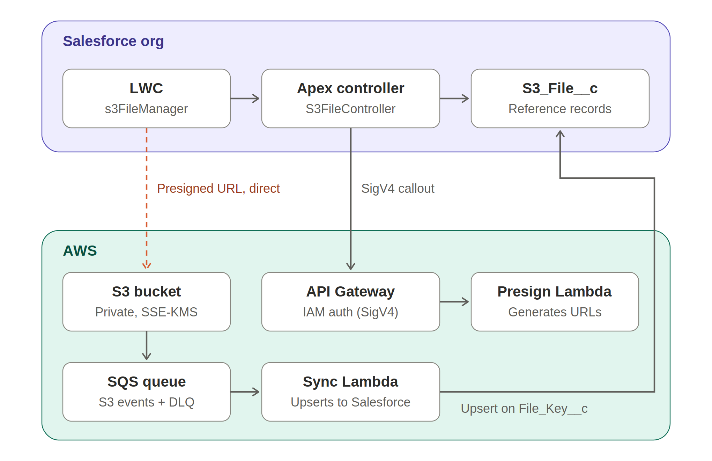

# Salesforce External File Storage on AWS

*Solution design: S3, API Gateway, and Lambda with Salesforce reference records*

**Status:** Draft for review

## 1. Overview

Storing and serving large files natively in Salesforce runs into governor limits: Apex heap size (6 MB synchronous, 12 MB asynchronous), callout response size (same limits), and the cost of loading `ContentVersion.VersionData` into memory. Storage costs for large volumes of files are also significant.

This design moves file content to Amazon S3 while keeping Salesforce as the system of record for file metadata and access control. The guiding principle is that **file bytes never pass through a Salesforce transaction**. Salesforce handles authorization and a small reference record per file, and the browser transfers content directly to and from S3 using short-lived presigned URLs.

### Key decisions

- **Metadata lives in Salesforce** as a lightweight custom object (`S3_File__c`), so listing, reporting, and SOQL work natively.
- **Serverless AWS backend** using API Gateway and Lambda rather than a long-running container service, since the backend mainly signs URLs and syncs events.
- **Direct browser-to-S3 transfer** via presigned URLs, which removes heap, callout-size, and timeout constraints from file transfer entirely.
- **AWS Signature Version 4 authentication** from Salesforce Named Credentials, avoiding custom token management.

## 2. Architecture

*Figure 1. Component architecture. The dashed line is the only path file content travels.*

| Component | Platform | Responsibility |
|---|---|---|
| `s3FileManager` LWC | Salesforce | File list, upload with progress, download, delete |
| `S3FileController` Apex | Salesforce | Access checks, callouts for presigned URLs, reference record management |
| `S3_File__c` | Salesforce | Reference record per file; queryable metadata |
| API Gateway (HTTP API) | AWS | IAM-authorized entry point for Salesforce callouts |
| Presign Lambda | AWS | Validates requests and generates presigned S3 URLs |
| S3 bucket | AWS | Encrypted, private storage of file content |
| SQS queue + DLQ | AWS | Buffers S3 object events with retry |
| Sync Lambda | AWS | Upserts file status and metadata back into Salesforce |

## 3. Salesforce Components

### 3.1 Data model: `S3_File__c`

| Field | Type | Purpose |
|---|---|---|
| `File_Key__c` | Text(255), External ID, Unique | S3 object key; the upsert key used by the sync Lambda |
| `Parent_Record_Id__c` | Text(18), External ID | Record the file belongs to (External ID flag provides indexing) |
| `File_Name__c` | Text(255) | Original file name, used on download |
| `Content_Type__c` | Text(100) | MIME type |
| `Size_Bytes__c` | Number(18,0) | Set from the S3 event |
| `Status__c` | Picklist | Pending, Available, Failed, Deleted |
| `ETag__c` | Text(100) | Integrity reference from S3 |

### 3.2 Access model

Using a text parent ID allows one component to work on any record page, but sharing is not inherited from the parent. The Apex controller is therefore the access gate:

- Set the organization-wide default for `S3_File__c` to Private.
- Before any operation, check `UserRecordAccess` on the parent record: Read access for listing and download, Edit access for upload and delete.
- Only after the check passes, query `S3_File__c` in system mode.

**Alternative:** if files will only attach to one or two object types, a master-detail relationship to each is simpler, because sharing is inherited automatically.

### 3.3 Apex controller: `S3FileController`

| Method | Parent access | Behavior |
|---|---|---|
| `getFiles(parentId)` | Read | Returns Available and Pending reference records for the parent |
| `startUpload(parentId, fileName, contentType, size)` | Edit | Generates the key, calls `/upload-url`, inserts a Pending record, returns URL(s) and record ID |
| `completeMultipart(fileId, uploadId, parts)` | Edit | Calls `/multipart/complete` with part numbers and ETags |
| `getDownloadUrl(fileId)` | Read | Calls `/download-url` and returns a short-lived URL |
| `deleteFile(fileId)` | Edit | Deletes the reference record; a trigger handles S3 deletion |

> **Callout ordering:** Apex throws "You have uncommitted work pending" if a callout follows DML in the same transaction. `startUpload` must generate the key, make the callout, and only then insert the Pending record.

All DML in the controller and triggers must be bulkified: collect records in a list and perform a single DML statement, never DML inside a loop.

### 3.4 Named Credential

- External Credential using the **AWS Signature Version 4** authentication protocol, service `execute-api`, and the target AWS region.
- STS AssumeRole into an IAM role permitted only `execute-api:Invoke` on this API.
- A permission set grants users access to the External Credential principal.

Salesforce signs every request, so there are no tokens or secrets to rotate in Apex.

### 3.5 Lightning Web Component: `s3FileManager`

- **Downloads** open the presigned URL via `window.open(url)`. This is navigation, so no CSP entry is required.
- **Uploads** use an XHR `PUT` to report progress. This requires a CSP Trusted Site for the bucket endpoint with the `connect-src` directive.
- **Files over roughly 100 MB** use S3 multipart upload, with parts uploaded in parallel and ETags collected for completion.
- Newly uploaded files show a Processing state until the sync Lambda marks them Available, typically within a few seconds.

## 4. AWS Components

### 4.1 API Gateway

An HTTP API with IAM authorization. All routes accept and return JSON.

| Route | Request | Response |
|---|---|---|
| `POST /upload-url` | fileKey, contentType, size | Single presigned PUT URL, or uploadId + part URLs + partSize for multipart |
| `POST /multipart/complete` | fileKey, uploadId, parts (number + ETag) | Final ETag |
| `POST /download-url` | fileKey, fileName | Presigned GET URL + expiry |
| `POST /delete` | fileKey | 204 No Content |

### 4.2 Presign Lambda

- Java 21 runtime with SnapStart enabled to reduce cold-start latency.
- Validates key format and content type, and signs `Content-Length` into PUT URLs so uploads cannot exceed the size Apex declared.
- Sets `response-content-disposition` on download URLs so files save with their original names.
- IAM role grants `s3:GetObject`, `s3:PutObject`, `s3:DeleteObject`, and `s3:AbortMultipartUpload` on the bucket, plus `kms:GenerateDataKey` and `kms:Decrypt` on the bucket key.

| URL type | Expiry |
|---|---|
| Download (GET) | 5 minutes |
| Single-part upload (PUT) | 15 minutes |
| Multipart part upload | 60 minutes |

### 4.3 S3 bucket

- One bucket per environment so sandboxes never touch production data.
- Block Public Access enabled, SSE-KMS encryption with an S3 Bucket Key, and versioning enabled.
- Lifecycle rules: abort incomplete multipart uploads after 7 days, transition objects to Intelligent-Tiering, and expire noncurrent versions.
- Key layout: `{parentId}/{uuid}/{sanitizedFileName}`.
- CORS: allow `GET` and `PUT` from the org's `*.lightning.force.com` My Domain origin, and expose the `ETag` header (required for multipart completion).

### 4.4 Event sync

S3 `ObjectCreated` events are delivered to an SQS queue with a dead-letter queue. The sync Lambda consumes messages in batches of up to 10 and performs one sObject Collections upsert on `File_Key__c`, setting the status to Available along with size and ETag.

- Authentication uses the OAuth 2.0 JWT bearer flow with an External Client App and a dedicated integration user.
- The private key is stored in AWS Secrets Manager; the access token is cached across invocations.
- S3 events are delivered at least once. Because the write is an upsert on an external ID, duplicate deliveries are harmless.

## 5. Request Flows

### 5.1 Upload

1. The LWC calls `startUpload` with the parent ID and file details.
2. Apex verifies Edit access on the parent and generates the file key.
3. Apex calls `/upload-url`, then inserts a Pending `S3_File__c` record.
4. The browser uploads directly to S3 using the presigned URL(s). Multipart uploads finish with a `completeMultipart` call.
5. The S3 event flows through SQS to the sync Lambda, which upserts the record to Available.
6. The LWC refreshes and shows the file as available.

### 5.2 Download

1. The LWC calls `getDownloadUrl`.
2. Apex verifies Read access on the parent and calls `/download-url`.
3. The LWC opens the returned URL; the browser downloads directly from S3.

### 5.3 Delete and cleanup

- An after-delete trigger on `S3_File__c` enqueues a Queueable that calls `/delete`, because triggers cannot make synchronous callouts.
- A nightly scheduled Apex job marks Pending records older than 24 hours as Failed, covering abandoned uploads.

## 6. Governor Limit Considerations

| Limit | Value | How the design stays within it |
|---|---|---|
| Apex heap size | 6 MB sync / 12 MB async | File content never enters Apex; payloads are small JSON |
| Callout response size | 6 MB sync / 12 MB async | Callouts return only URLs and metadata |
| Callouts per transaction | 100 | One callout per controller method |
| Callout timeout | 120 seconds | Presigning completes in milliseconds; API Gateway integration timeout is 29 seconds by default |
| DML statements per transaction | 150 | One insert per controller call; bulkified triggers |
| DML rows per transaction | 10,000 | Lambda batches via sObject Collections (up to 200 records per request) |
| Daily API requests | Edition-dependent | SQS batching reduces the number of REST calls from the sync Lambda |

## 7. Security Summary

- Authorization is enforced in Apex against the parent record before any URL is issued; AWS trusts only SigV4-signed requests from the Named Credential role.
- Presigned URLs are scoped to a single object key and expire within minutes.
- The bucket is private, encrypted with KMS, and blocks all public access.
- IAM roles follow least privilege: invoke-only for Salesforce, bucket-scoped for the presign Lambda.
- Enable CloudTrail data events on the bucket if an audit trail of file access is required.
- File content resides outside the Salesforce trust boundary. Confirm retention, data residency, and any regulatory requirements (such as HIPAA or FINRA) before go-live.

## 8. Next Steps

1. AWS SAM template: bucket, KMS key, SQS queue and DLQ, both Lambdas, HTTP API, and IAM roles.
2. Presign Lambda implementation (Java 21, AWS SDK v2).
3. Sync Lambda implementation with JWT bearer authentication.
4. Salesforce metadata: `S3_File__c`, Named Credential, External Credential, permission set, CSP Trusted Site.
5. Apex controller, trigger, Queueable, scheduled cleanup job, and test classes with callout mocks.
6. `s3FileManager` LWC with single-part and multipart upload.
7. Load testing with large files and concurrent uploads.
